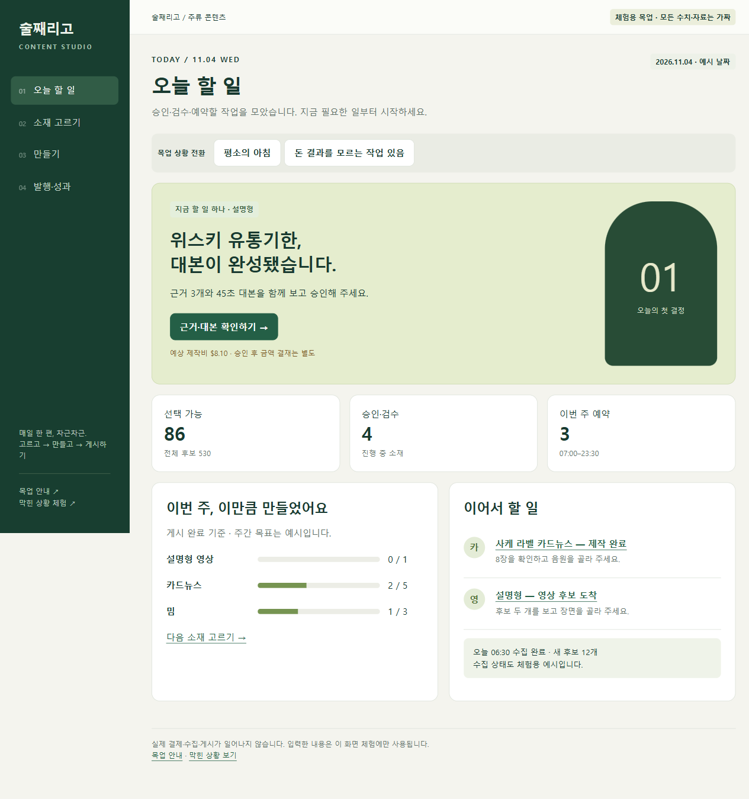
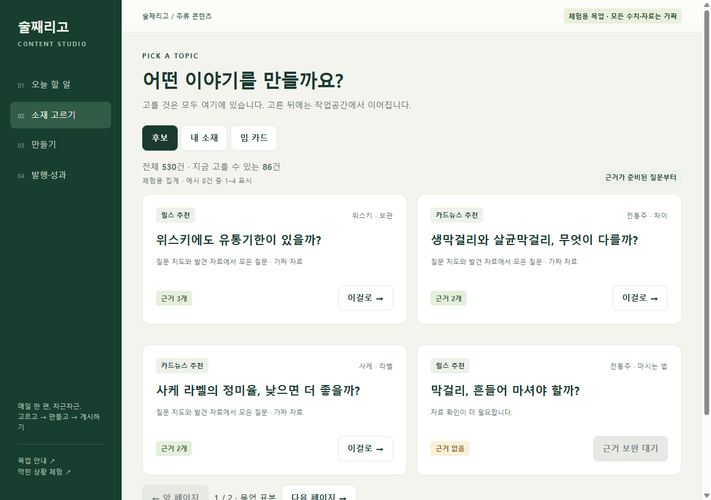
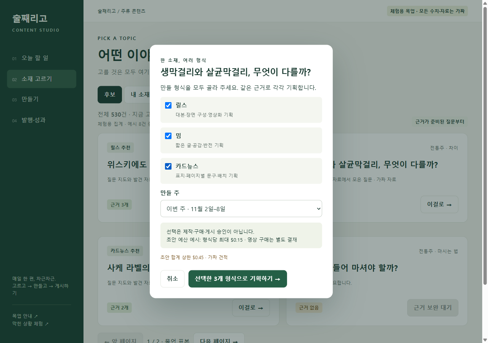
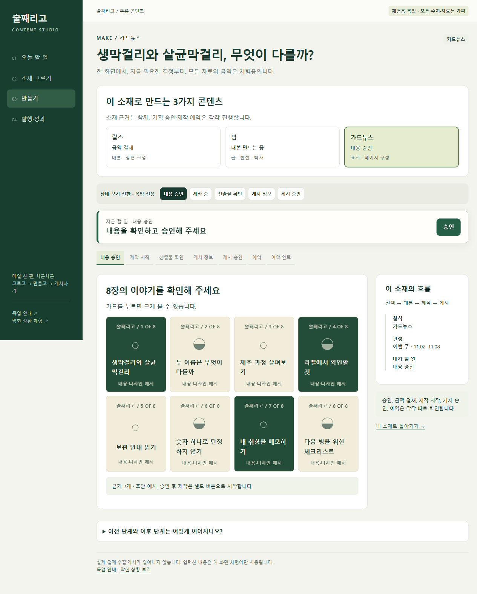
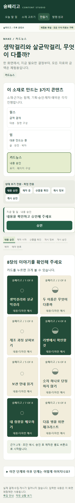

# 술째리고 대시보드 기획서 v3 — 한 소재, 여러 형식

작성일: 2026-11-05. **화면 검토용 목업이며 서비스 구현 완료 문서가 아니다.** v2 전체를 대체하는 백엔드 설계가 아니라, 운영자와 추가 합의한 화면·흐름을 정리한다.

## 1. 이번에 확정한 방향

- ‘오늘’ 메뉴를 **오늘 할 일**로 바꾼다. 승인·검수·예약·문제 확인 등 지금 처리할 일을 모으는 첫 화면이다.
- **소재 고르기**가 유일한 선택 입구다. 후보 / 내 소재 / 밈 카드 탭을 둔다.
- 소재 하나를 선택한 다음 **릴스 / 밈 / 카드뉴스 중 하나 이상을 복수 선택**한다. 추천 형식 하나를 강제하지 않는다.
- 선택한 형식별 대본·영상화·페이지 기획으로 넘어간다. 한 소재의 공통 근거를 함께 보되 각 형식의 승인·제작·게시 상태는 독립적이다.
- 한 형식을 승인하거나 실패했다고 다른 형식이 자동으로 승인되거나 중단되지 않는다. 단, 공통 근거가 무효가 되면 영향을 받는 형식에는 차단을 표시한다.

## 2. 쉬운 메뉴

| 메뉴 | 무엇이 보이나 | 다음 행동 |
|---|---|---|
| 오늘 할 일 | 가장 시급한 일 하나, 대기 건수, 주간 게시 진행 | 해당 소재의 해당 형식·단계로 이동 |
| 소재 고르기 | 후보·내 소재·밈 카드 | 소재와 만들 형식을 고름 |
| 만들기 | 진행 중인 내 소재 | 선택한 형식별 기획·제작 이어가기 |
| 발행·성과 | 예약 달력, 실패, 게시별 조회·저장·공유 | 예약 확인·문제 해결·다음 소재 선택 |

수집원·실행 기록·설정은 이 목업의 핵심 동선 밖이다. 실제 서비스에서 삭제한다는 뜻이 아니다.

## 3. 세 형식의 의미

| 선택 | 만드는 기획 | 제작 결과 |
|---|---|---|
| 릴스 | 대본·장면 구성·시각 설명·영상화 계획 | 원리나 차이를 설명하는 세로 영상. 기존 설명형 레인에 대응 |
| 밈 | 글 2~3줄·공감·반전·박자 계획 | 짧은 밈 영상. 박자 맞춤이 필요하면 앱에서 직접 음원 부착·게시 |
| 카드뉴스 | 표지·페이지별 문구·순서·배치 계획 | **기본: 넘겨 보는 카드 게시물** |

카드뉴스의 부가 게시 방식으로 ‘카드 내용을 릴스로 재생’을 제공하는 것은 **목업의 제안**이다. 이를 선택하면 음원이 필수다. 세 가지 주요 형식과 게시 방식을 혼동하지 않는다. 이 부가 옵션의 실제 도입 여부는 구현 전 확인할 항목이다.

## 4. 전체 동선

1. 오늘 할 일에서 ‘위스키 유통기한 — 내용 승인 대기’를 연다.
2. 릴스 근거·대본·견적을 확인한다. 내용 승인, 금액 결재, 구매 요청은 따로 누른다.
3. 소재 고르기에서 ‘생막걸리와 살균막걸리’를 고른다.
4. 릴스·밈·카드뉴스를 원하는 조합으로 선택하고 주차와 초안 합계 예산을 확인한다.
5. [선택한 N개 형식으로 기획하기]를 누르면 소재 작업공간이 열린다. 선택하지 않은 형식은 생성하지 않는다.
6. 상단에 선택한 형식과 각 진행 상황이 보인다. 현재 보는 형식을 강조한다.
7. 릴스는 대본·장면 구성, 밈은 글·반전, 카드는 페이지 구성을 각각 검토한다.
8. 준비된 형식부터 승인·제작·검수·게시 승인·예약한다. 동시에 모두 끝낼 필요가 없다.
9. 발행·성과에서는 같은 소재라도 형식별 게시물과 성과를 따로 확인한다.

## 5. 작업공간

상단: 소재 제목 → 형식별 진행 카드 → 현재 형식의 ‘지금 할 일’ 고정 바 → 단계 표시 → 현재 검토 내용.

- 공통: 소재·질문·근거를 확인할 수 있다. 공통 근거 사용은 같은 기획 복제를 뜻하지 않는다.
- 릴스: 내용 승인 → 결재 → 구매 → 후보 각각 합격/불합격 → 합격 후보 선택+이유 → 조립 → 과정 3항목 → 품질 6항목 → 산출물 승인 → 게시 정보 → 승인 요청 → 공개 게시 승인 → 예약.
- 카드: 페이지 기획 승인 → 제작 시작 → 카드 확인·산출물 승인 → 게시 방식·캡션·시각 → 승인 요청 → 공개 게시 승인 → 예약. 카드 릴스일 때만 음원 필수.
- 밈: 글 기획 승인 → 제작 시작 → 산출물 승인 → 박자 맞춤 없음: 게시 승인·예약 / 박자 맞춤 필요: 앱에서 게시 후 URL 기록.
- 공통 금지: 내용 승인으로 결재·구매·공개 게시를 묵시적으로 승인하지 않는다.

## 6. 오늘 할 일에 들어가는 것

- 돈이나 게시 결과가 불명확한 작업을 우선 안내한다. 재구매·재게시는 잠근다.
- 평소에는 내용 승인, 영상 후보 선택, 산출물 검수, 게시 승인처럼 운영자의 판단을 기다리는 작업을 보여 준다.
- 숫자는 선택 가능한 후보 수 / 판단 대기 작업 수 / 예약 게시 수로 구분한다. 소재 수와 형식 작업 수를 혼용하지 않는다.
- 이번 주 진행은 형식별 게시 완료 기준으로 센다. 목표는 결재가 아니다.
- ‘확인 후 나중에’는 표시 순서만 바꿀 수 있고 실제 차단을 해제하지 않는다(실제 구현 상세는 다음 설계).

## 7. 이미지로 보는 새 화면

### 오늘 할 일

### 소재 고르기

### 한 소재에서 여러 형식 선택

### 선택한 형식별 작업공간

### 휴대폰 폭의 형식별 작업공간

## 8. 목업의 한계

모든 근거·가격·음원·성과는 가짜다. 영상도 직접 만든 도형 모형이다. 후보 530건은 집계 예시이고 8개만 체험한다. 예시 날짜는 2026-11-04로 고정한다. 실제 생성·결제·예약·게시를 실행하지 않는다.

복수 선택 작업은 브라우저 세션 안에서 형식별 진행을 기억한다. 파일 접근 정책에 따라 저장이 제한될 수 있으며, 영구 저장·실제 복구 보장은 없다. 기본 데모 링크와 달력은 고정 예시다. 문서와 캡처는 구현의 증거가 아니다.
